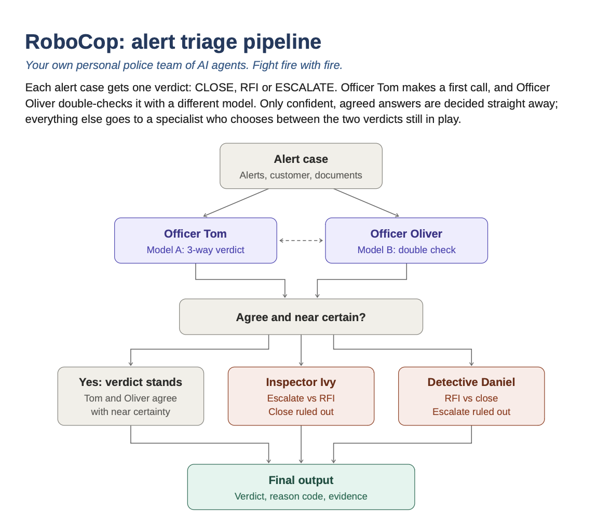

# Alert triage system

`system/run <institution folder> <output file>` reads one institution folder and writes one JSON
line per case: `CLOSE`, `RFI` or `ESCALATE`, with a reason code, a 2–4 sentence reason that names
the case's own documents, people, amounts and dates, and the IDs of the evidence relied on.

## Model, time and cost

- **No language model.** The system is plain Python 3 using only the standard library, and makes no network calls.
- **Time:** a run of 200 cases takes about 3 seconds. A run of 1,000 cases takes about 12 seconds.
- **Cost:** £0 / $0.
- **Deterministic:** there is no randomness and the system keeps no state between runs, so all five runs give byte-identical output (same verdicts, codes, reasons and evidence).
- **Files touched:** it reads only the folder it is given and writes only the output file. It works from any working directory.

## How it decides

The decision follows the institution's `POLICY.md` and the cost of each mistake. A wrongful CLOSE costs 10, so a case closes only when a document positively explains **every** alert in it. Once anything points to crime, the case escalates instead of asking the customer (to avoid tipping them off).

1. **Load and normalise** (`triage/data.py`): cases, alerts, customers, transactions, evidence (including the `**Key:** value` fields in each Markdown document), previous reviews and the internal list.
2. **Institution scenario logic** (`triage/scenarios/<institution>.py`). This is where every development case is decided. Each module runs an ordered chain of checks:
   - **Signs of crime → ESCALATE.** Fraud reports from paying banks, staff notes about avoiding thresholds, a dissolved company paying in, explanations that contradict each other or the transactions, unrelated third parties moving money to higher-risk countries, money passed straight on to linked parties, and a listed party who still controlled the counterparty on the payment date.
   - **Internal list matches (TM22).** The list entry's date of birth, address, unit number and officer or control dates are compared with registers, receipts and gift letters. If they show a different party, close. If they show the listed party or its controller, escalate. A match on the name alone gets an RFI.
   - **Explanations → CLOSE.** The documents on file must match the alerted transactions on amount, counterparty, account number, reference and date. That can be invoices, contracts, payment files, completion statements, solicitor's, insurer's and settlement letters, takings and collection records reconciled deposit by deposit, booking lists covering every payer, statements proving an own account, group charts, credit notes matching an earlier payment, or re-verification records for dormant accounts.
   - **Policy guards.** Own-account activity at **5× or more** of the declared income or volume goes to `RFI_UPDATED_PROFILE`. At the payments and FX firm, a held payment of **£10,000 or more** to anyone but the client is released only when a document on file carries that amount. An earlier review never explains new or larger activity.
   - **Contradicting documents → ESCALATE.** Examples are an invoice that doesn't match the payment, a statement held by someone else, or failed re-verification.
   - **Explained by nothing, suspicious in nothing → RFI.** The reason names exactly what to ask for, such as the completion statement, the loan agreement, the booking list, or a statement for the own-name account.
3. **Generic fallback** (`triage/engine.py`). This is a per-rule engine (TM01–TM10, TM22) for any case no scenario module recognises. It applies the same principles and, when unsure, never closes. No development case currently reaches it.
4. **Output checks** (`engine._finish`). The reason code must belong to the verdict, and cited IDs must exist in the folder. If a case can't be read, it is escalated rather than dropped.

The logic only ever uses document types, text patterns and matches between documents and transactions. It contains no case IDs, names, amounts or document IDs from the development data.

## Development results

| Institution | Cases | CLOSE | RFI | ESCALATE | Validator errors |
|---|---|---|---|---|---|
| Bank | 1000 | 500 | 250 | 250 | 0 |
| E-money | 1000 | 500 | 250 | 250 | 0 |
| Investment | 1000 | 500 | 250 | 250 | 0 |
| Payments and FX | 1000 | 500 | 250 | 250 | 0 |

## Planned next version: RoboCop

> **Not implemented yet.** The submitted system is the rules engine described above. This is the
> design for the next version.

RoboCop is a team of language-model agents, called through OpenRouter as the brief requires:

- **Officer Tom** (model A) makes a first three-way call on each case.
- **Officer Oliver** (a different model, B) double-checks it independently.
- **Verdict stands:** if Tom and Oliver agree with near certainty, that verdict is final.
- **Inspector Ivy** takes cases where CLOSE has been ruled out, and chooses between ESCALATE and RFI.
- **Detective Daniel** takes cases where ESCALATE has been ruled out, and chooses between RFI and CLOSE.

To keep within the brief's limits, the plan is:

- **Reproducible:** temperature 0, with answers cached inside `system/` and keyed by a hash of the case, so all five runs match.
- **Within budget:** about $4 per 200 cases.
- **Grounded:** the rules engine's findings (matched documents, policy guards, red flags) go into every prompt as evidence.
- **Safe fallback:** if no API key is set or a call fails, the rules engine decides the case.

## Tools (outside `system/`)

| Command | What it does |
|---|---|
| `tools/run_all.sh` | Runs all four institutions, validates the output and checks a second run is identical |
| `python3 tools/validate.py <folder> <output>` | Checks the output schema, reason codes, evidence IDs and reason length |
| `python3 tools/signatures.py <folder>` | Groups cases by rules fired and document types |
| `python3 tools/show_case.py <folder> <case_id>` | Shows everything on file for one case |
| `python3 tools/score.py <labels> <output>` | Scores the output against hand labels with the brief's cost matrix |
| `python3 -m unittest discover tests` | Runs the generic-engine tests on synthetic fixtures |
